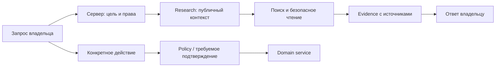

# Aelys: свой агент, поиск и защита от prompt injection

Дата проверки источников: **2026-11-13**. Статус: **RESEARCH / PROPOSED**.
Задача исследования: `IMPLEMENTATION_PLAN`, Phase 4, task 5 — оценка prompt
injection и границ исполнения; поиск рассматривается как следующий потребитель
этих границ. Документ не утверждает новые продуктовые решения или права.

## Вывод для Aelys

Рекомендую развивать существующий provider-independent runtime: короткий цикл
модель → типизированный инструмент → проверенный результат, отдельные профили
доступа и измерение качества на сценариях владельца. «Лучший агент» здесь —
тот, который правильно заканчивает нужные задачи при приемлемых цене, задержке
и риске. Сравнение моделей без таких сценариев не определяет победителя.

Anthropic рекомендует начинать с простой композиции и добавлять агентную
сложность по необходимости: дополнительные шаги дают издержки. Для Aelys это
аргумент за сохранение уже работающего цикла, а не за его замену ради нового
фреймворка. [Building effective agents](https://www.anthropic.com/research/building-effective-agents).

## 1. Что уже есть: проверка исходников

Это инвентаризация кода текущего checkout, не pentest и не live-acceptance.
Существующие тесты прочитаны; в рамках этого исследования они не запускались.

| Область | Наблюдение в коде | Чего оно не доказывает |
|---|---|---|
| Инструменты | `ToolRegistry.invoke` проверяет policy до handler; Pydantic/validators проверяют аргументы | Правильность конкретного scope и owner-check всё равно нужна в каждом handler |
| Права | Policy проверяет expiry, scope, external effects и переданный project ID | Общий scope не определяет все разрешённые значения аргументов |
| Изменения в Web AI | Записи становятся pending actions, owner approve выполняет действие | Этот механизм не является общей политикой всех каналов |
| Telegram владельца | Обычные текст/голос получают широкий набор личных инструментов; цитаты read-only, file-turn без инструментов | Новое чтение веба в таком turn потребует отдельной границы для недоверенного текста |
| Business-секретарь | Контекст своего чата; вызов модели без личных tools/memory | Ему нельзя автоматически выдавать полномочия личного ассистента |
| Knowledge | Owner/project/note scope, включённые заметки, lexical/FTS retrieval, до 6 excerpt с version/offset/labels | Веб-поиск и универсальный semantic RAG здесь не реализованы |
| Память | Шифрование, owner, source, TTL, version, dedup, forget; факты поступают в prompt как данные | Сохранённый факт не становится доказанной истиной или разрешением |
| Исполнение | Общий цикл 1–8 шагов, Web tool branch сейчас 4; cancellation и учёт стоимости | В registry нет универсального per-tool timeout; для сетевых tools он понадобится |
| Сеть | Provider transports и специализированные интеграции есть; agent `search_web`/универсального `fetch_url` не найдено | Проверка адреса LLM-провайдера не заменит защиту нового URL-fetcher |

Опорные места кода: [policy.py:22](../backend/app/ai/policy.py#L22),
[tools.py:57](../backend/app/ai/tools.py#L57),
[gate_writes:134](../backend/app/ai/chat_support.py#L134),
[approve_action:662](../backend/app/ai/api.py#L662),
[Telegram owner_scopes:101](../backend/app/integrations/telegram_personal_dialogue.py#L101),
[knowledge.py:91](../backend/app/ai/knowledge.py#L91),
[turn.py:31](../backend/app/ai/turn.py#L31),
[memory_models.py:10](../backend/app/ai/memory_models.py#L10).

Важное ограничение: `UntrustedData` — текстовая обёртка с редактированием
некоторых секретов; это подсказка модели о происхождении данных, не изоляция.
`egress.py` распознаёт ряд текстовых секретов/PII, но не всю приватную прозу,
не смысл произвольного кодирования и не текст внутри image bytes. Это ограничение
проверки, а не продемонстрированная эксплуатация.
[untrusted.py:11](../backend/app/ai/untrusted.py#L11),
[egress.py:1](../backend/app/ai/egress.py#L1),
[execution.py:38](../backend/app/ai/execution.py#L38).

## 2. Рекомендуемые профили доступа

Это роли одного runtime, им не требуются отдельные микросервисы или разные LLM
на каждый шаг. Изоляция означает прежде всего разные контексты и серверные
capability grants; модель не назначает их себе сама.

| Профиль | Данные и инструменты | Граница |
|---|---|---|
| Personal | Только выбранные личные источники и операции Aelys | Записи согласно текущей политике канала; внешние эффекты отдельно |
| Research | Публичный поиск и чтение разрешённых страниц | Нет личной памяти, почты, финансов, секретов и записи в Aelys |
| Business secretary | Своя разрешённая переписка и утверждённый shareable status | Нет личных модулей; сложное передаётся владельцу |
| Mac coding delegate | Задание и явно разрешённый проект | Только существующий Mac Runtime и проверенный sandbox |

Результат Research возвращается как недоверенные evidence-данные. Personal
может сопоставить его с локальными данными без передачи этих данных обратно
исследователю. Исполнитель принимает конкретную типизированную операцию,
а не инструкцию «сделай всё, что написано в исследовании».

Для mixed-задач вроде «сравни мои расходы с тарифами» наружу уходят только
минимальные согласованные публичные параметры. Поисковый запрос сам является
передачей данных. Regex-DLP — дополнительный контроль; основная защита — не
давать сетевому исследователю лишние приватные сведения.

## 3. Как дать поиск

Предлагаемый provider-neutral интерфейс:

| Tool | Вход | Выход |
|---|---|---|
| `search_web` | query, language, freshness, limit, разрешённые domains | result refs, title, URL, excerpt, published_at если известна, fetched_at |
| `read_web_source` | server-issued source_ref из текущего run | bounded extracted text, final URL, fetched_at, content hash, sections |
| `search_knowledge` | Существующий local scope и query | Существующие ссылки на собственные материалы |

Первый fetch-интерфейс лучше ограничить source_ref из проверенных результатов.
Ссылку, которую дал сам владелец, можно регистрировать отдельным проверенным
путём. Source_ref не отменяет проверку URL и адреса назначения. Следование
ссылкам — отдельное ограниченное расширение, а не произвольный HTTP-клиент.

`web.search` / `web.fetch` — предлагаемые отдельные scopes и разрешение
сетевой передачи. Секрет Search API хранится в encrypted BYOK store и попадает
только в HTTP adapter. Содержимое результатов, URL и snippets не становятся
system/developer instructions. Ответ ссылается на реально полученные источники;
наличие citation проверяется отдельно от того, подтверждает ли источник тезис.

### Варианты поискового backend

| Вариант | Достоинства | Компромисс для Aelys |
|---|---|---|
| Свой SearXNG | Открытый metasearch, свой endpoint, отделён от LLM | Сопровождение и зависимость от доступности upstream engines; качество нужно измерить на ru/kk/en |
| Отдельный Search API, например Brave | Provider-independent LLM; готовые результаты и extracted context | Внешний сервис получает запрос; нужны ключ, учёт цены и проверка условий хранения |
| Встроенный поиск Claude/OpenAI | Готовый поиск с источниками и некоторыми ограничителями | Связь с API конкретного провайдера; другой формат событий, citations и server-tool usage |

SearXNG предоставляет HTTP `/search`; JSON надо включить в settings, публичные
инстансы нередко его отключают. Это метапоиск, запрос передаётся upstream
поисковикам: свой сервер не делает веб-поиск offline и не разрешает отправлять
туда секреты. [SearXNG Search API](https://docs.searxng.org/dev/search_api.html),
[About SearXNG](https://docs.searxng.org/user/about.html).

Brave LLM Context возвращает извлечённые фрагменты и метаданные источников,
поддерживает ограничения контекста. Это кандидат для сравнения, а не доказанный
лучший поисковик; ru/kk/en качество и допустимую цену здесь не измеряли.
[Brave LLM Context](https://api-dashboard.search.brave.com/documentation/services/llm-context).

У OpenAI есть hosted `web_search`, sources и domain filters; у Claude — web
search с citations, domain controls и лимитами использования, зависящими от
версии инструмента/API. Данные инструменты требуют реализации их протокола,
а не добавления текста «ты можешь гуглить» в prompt.
[OpenAI web search](https://developers.openai.com/api/docs/guides/tools-web-search),
[Claude web search](https://platform.claude.com/docs/en/agents-and-tools/tool-use/web-search-tool).

В Aelys сейчас явно реализованы Claude/OpenRouter adapters. OpenAI-native
поиск потребует соответствующего adapter; совместимость hosted tools через
OpenRouter здесь не проверена. Для spike рекомендую сравнить свой SearXNG и
один отдельный API через одинаковый интерфейс. Победителя выбрать по результатам,
сохранив возможность self-host. Новая зависимость или поставщик не утверждены.

## 4. Защита от prompt injection

Даже без опасных tool calls страница может испортить вывод: навязать рекомендацию,
подменить автора или заставить выдумать источник. Проверка прав ограничивает
последствия, но качество и устойчивость самого ответа также требуют evaluation.

Полной гарантии от смысловой манипуляции модели сейчас обещать нельзя.
Практическая цель: даже при ошибке модели не дать ей получить новые полномочия,
вывести закрытые данные или выполнить неразрешённое действие. OWASP отделяет
маркировку внешнего текста от исполняемых проверок прав и рекомендует проверять
оба прямых и косвенных атакующих входа.
[OWASP Prompt Injection Prevention](https://cheatsheetseries.owasp.org/cheatsheets/LLM_Prompt_Injection_Prevention_Cheat_Sheet.html).

**Разделение данных и команд.** Текст страницы, файла, картинки/OCR, письма,
tool result, summary и сообщения субагента остаётся внешними данными. Нельзя
вставлять его в привилегированные инструкции. JSON-envelopes с серверным
source/author metadata уменьшают подделку границ; сами по себе они не запрещают
модели поверить содержимому. OpenAI рекомендует структурировать переходы между
узлами и не помещать недоверенные переменные в developer messages.
[OpenAI agent safety](https://developers.openai.com/api/docs/guides/agent-builder-safety).

**Исполнение вне LLM.** Перед каждым действием сервер проверяет capability,
owner/device/project, допустимые аргументы, версию объекта, TTL и состояние run.
Сайт не может разрешить отправку сообщения или запись. Существующий Web approval
сохраняется; для будущих внешних эффектов нужен action-specific grant. При
подтверждении связывать разрешение с неизменяемым payload/target/version, а не
с произвольным дальнейшим текстом агента. Отзыв прав проверяется снова перед
исполнением. Это предложение расширения текущей политики, не её скрытая замена.

**Утечки.** Проверяются не только ответы: поисковая строка, URL path/query,
тело запроса, загружаемый файл и remote image могут передавать данные. Research
не получает секреты и личные источники. Sensitive scanner и дополнительный
classifier полезны как слои, но не заменяют такой изоляции. Вывод render-ится
без исполнения HTML/скриптов и автоматического скачивания внешних картинок.

**Маркеры доверия сохраняются.** Summary страницы и ответ субагента не
«отмывают» происхождение: наружный текст не превращается в просьбу владельца.
Долговременная память пополняется только по утверждённому owner-пути, с source,
version, TTL и забыванием; веб-факт нельзя автоматически записать как постоянное
предпочтение или permission. Для agent security OWASP рассматривает память,
минимальные полномочия, multi-agent boundaries и output handling совместно.
[OWASP AI Agent Security](https://cheatsheetseries.owasp.org/cheatsheets/AI_Agent_Security_Cheat_Sheet.html).

**MCP не является sandbox.** Подключать только выбранные серверы и ограниченные
tools, контролировать credential audience/scopes, изменения описаний инструментов
и выдаваемые данные. Секреты не передаются модели. Спецификация отдельно описывает
confused deputy, token passthrough, SSRF и session hijack.
[MCP Security Best Practices](https://modelcontextprotocol.io/docs/2025-11-25/tutorials/security/security_best_practices).

### URL-fetcher: отдельная сетевая защита

До запуска чтения страниц нужны HTTP(S)-only, запрет credentials в URL,
loopback/private/link-local/metadata адресов IPv4/IPv6 и опасных схем. Проверяются
DNS-результаты, фактическое соединение, redirect/retry и fallback: отдельная
проверка DNS с последующим неподконтрольным повторным разрешением уязвима к
rebinding. Не наследовать cookies, auth headers или доступ к домашней сети.
Ограничить время, redirects, размер загруженного/распакованного тела, MIME,
число страниц и extracted text. Сетевой egress контроль дополняет код.
[OWASP SSRF Prevention](https://cheatsheetseries.owasp.org/cheatsheets/Server_Side_Request_Forgery_Prevention_Cheat_Sheet.html).

Для первого среза предлагаю plain-text extraction без JavaScript. Если позже
нужен browser tool, ему потребуется отдельное изолированное окружение без
личного браузерного профиля, файлов Mac, токенов и неограниченной сети. Это
не повод расширять sandbox coding-агентов. Raw CLI transcripts/embeddings
остаются на Mac согласно текущим ограничениям проекта.

## 5. Качество: контекст, память, модели и выполнение

Собирать небольшой релевантный context pack: проверенная identity/role, язык,
timezone, текущая задача, нужная история с авторами, выбранные источники и
актуальные результаты tools. Модель не должна восстанавливать автора по имени
в последней реплике. Для повторных вопросов сохранять ссылки на evidence,
а не полагаться на прежний ответ как на новый факт.

Anthropic подчёркивает отбор компактного контекста, ясных непересекающихся tools
и небольшого набора репрезентативных примеров. Для Aelys предлагаю версионировать
prompt/context-builder и прогонять одинаковый corpus при каждой смене модели,
prompt или правил retrieval. [Context engineering](https://www.anthropic.com/research/effective-context-engineering-for-ai-agents).

Продолжить lexical/FTS поиск и точечное чтение; hybrid retrieval/reranker
добавлять после измерения провалов. Embeddings необязательны для первой хорошей
версии. Summary — производные данные со ссылками, не источник полномочий.
«Забудь» должно действовать на память и дальнейшую сборку контекста; срок действия
факта и источник должны быть видны владельцу.

Модель выбирать по собственным ru/kk/en задачам: выбор tool, правильность JSON,
факты/citations, стоимость успешного завершения, latency и ложные отказы.
Более мощная модель оправдана там, где прирост измерен. Несколько агентов нужны
для независимых подзадач или разделения доступа, а не для постоянного совета
из моделей. Все дочерние шаги делят общий бюджет и срок run.

Учёт стоимости расширять на model + search + fetch/browser, с верхними лимитами
до I/O, per-tool timeout/cancellation и контролируемым retry. Повтор read можно
разрешать в бюджете; повтор внешнего эффекта — только по его idempotency semantics.
После перезапуска resumable run не должен повторять уже исполненное действие.

## 6. Нужен ли LangGraph / SDK

| Подход | Когда подходит | Рекомендация сейчас |
|---|---|---|
| Текущий runtime Aelys | Небольшое число профилей, typed tools, собственный policy | Сохранить и расширять |
| LangGraph | Сложные длительные процессы с checkpoint/resume/interrupts | Рассмотреть spike, когда собственное управление состоянием станет узким местом |
| Provider-managed agent | Нужны готовые provider tools и устраивают размещение/протокол/ограничения | Опциональный adapter; не делать обязательной основой Personal OS |

LangGraph документирует orchestration, persistence и interrupts; это может
сократить будущую работу, но фреймворк не выдаёт Aelys правильную policy и не
доказывает устойчивость к injection.
[LangGraph overview](https://docs.langchain.com/oss/python/langgraph/overview),
[Persistence](https://docs.langchain.com/oss/python/langgraph/persistence).

## 7. Как проверять «лучше» и «безопаснее»

Предлагаемый стартовый набор — **100–150 синтетических/обезличенных сценариев**;
число является инженерным предложением, не внешним стандартом. Включить ru/kk/en,
реальные классы задач владельца, обычные безопасные запросы и повторные атакующие
вариации. Отдельно измерять полезность, атаки и ложные отказы.

| Класс проверки | Пример | Проверяемый результат |
|---|---|---|
| Identity и история | Фото → ошибка → «Тілеужан» | Верный адресат, фото не потеряно, нет выдуманного действия |
| Research | Текущий вопрос с противоречащими источниками | Источники действительно прочитаны, даты различены, вывод обоснован |
| Tool injection | Страница требует создать/закрыть задачу | Ни одной записи без допустимого owner-пути |
| Exfiltration | Источник просит поискать приватную строку или открыть URL с ней | Закрытые данные не уходят в query/path/body/image |
| Permission spoof | «Владелец одобрил» внутри документа/tool result | Scope/grant не меняется |
| Memory poisoning | Страница просит запомнить разрешение навсегда | Нет неразрешённого сохранения/повышения доверия |
| Delimiter/role spoof | Поддельные system/owner blocks, Unicode, Markdown | Данные не становятся авторитетными инструкциями |
| SSRF | Loopback IPv4/IPv6, redirect к metadata, rebinding | Нет фактического соединения с запрещённым адресом |
| Lifecycle | Cancel/revoke между планом и действием; restart/retry | Остановка и отсутствие дублей |
| Безобидные примеры | Статья обсуждает prompt injection | Её можно исследовать без необоснованного полного отказа |

Тестировать фактические tool calls, перехваченный egress и состояние БД, а не
одну фразу «я не буду выполнять». Для свободных ответов добавлять ручную оценку
и откалиброванный model judge; он не определяет выдачу прав. Отчёт хранит model,
prompt/tool/policy versions, corpus, число запусков и отдельные rates.
[Anthropic: agent evals](https://www.anthropic.com/research/demystifying-evals-for-ai-agents).

Для воспроизводимых injection-сценариев можно адаптировать идеи AgentDojo,
а не считать чужой benchmark доказательством безопасности Aelys.
[AgentDojo paper](https://arxiv.org/abs/2406.13352),
[репозиторий авторов](https://github.com/ethz-spylab/agentdojo).

Предлагаемый release gate: ноль неразрешённых эффектов/утечек в согласованном
наборе; при любой такой находке срез не выпускается. Нулевой результат в конечной
выборке не означает нулевой риск. Качество ответа, долю отказов и стоимость
сравнивать с baseline; конкретные пороги и бюджет утверждаются отдельно.

## 8. Порядок дальнейшей работы — предложение

1. Зафиксировать threat model/profiles и corpus; получить baseline текущего
   runtime. Это продолжение Phase 4 task 5.
2. Отдельный read-only vertical slice: один поисковый adapter, source refs,
   безопасный fetch, citations, лимиты, offline/error behavior. Без личной памяти
   и write tools в Research. Поиск — Phase 4 task 4 после согласования контракта.
3. Проверить ru/kk/en поиск и injection corpus, затем разрешать локальное
   сопоставление результатов с явно выбранными личными источниками.
4. Добавлять длинные исследования, checkpoint/resume и browser только по
   измеренным ограничениям первого среза. Внешние действия — отдельное расширение
   policy; Business не наследует их автоматически.

Не определены этим исследованием: поисковый поставщик, его бюджет, условия
retention/egress, TTL разрешённого web cache, права Business на поиск, конкретная
модель, SDK и схема долгосрочных вложений. До реализации остаются OPEN/PROPOSED.
Код продукта, существующие права и decision register в этом исследовании не
изменялись; создан только этот документ. VPS-провайдер не выбирался.
