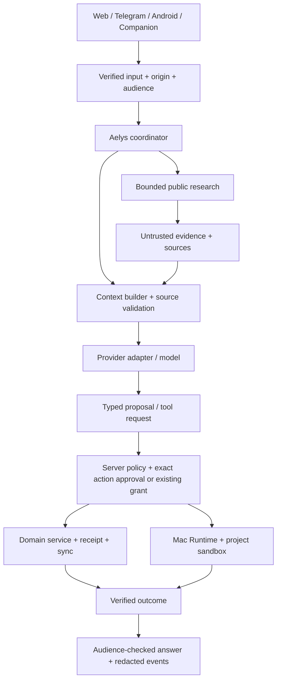

# Aelys как личный agent harness: исследование и архитектурное предложение

Дата проверки: **2026-11-13**. Снимок кода: `1b2ab41`.
Статус: **RESEARCH / PROPOSED**, не новая утверждённая архитектура.
Привязка текущей работы: исследование предлагаемого расширения
`IMPLEMENTATION_PLAN` Phase 4 / task 3 («Read and create_task tools via domain
services»). Это не заявление о выполнении этой задачи: сейчас планируется общий
путь инструментов и первый сквозной сценарий. Остальные этапы ниже
— зависимости и будущий backlog, не обещание выполнить весь roadmap одним изменением.

## 1. Что именно строим

Владелец описал весь Aelys как свой личный harness. Это хорошо согласуется с
исходной идеей Personal OS: приложение владеет состоянием, источниками знаний,
доступом к инструментам и результатами. Модель — заменяемый исполнитель
рассуждений. Telegram, Web, Android и Companion — входы в эту систему.

Рабочее определение для проекта:

> Aelys Harness принимает проверенный запрос/событие, выбирает профиль и контекст,
> вызывает модель, проверяет её предложения, исполняет разрешённые операции через
> сервисы приложения и сохраняет проверяемый результат, стоимость и происхождение.

«Свой harness» не требует обучать свою LLM, копировать закрытые system prompts
или писать собственный CLI-агент для всех задач. Хорошие промпты версионируются
вместе с тестами; права, изоляция и транзакции остаются исполняемым кодом.
Личный harness должен уметь завершить задачу и честно показать, что произошло.

## 2. Что действительно уже существует

Это статическая инвентаризация исходников, не новый runtime/security acceptance.
Предыдущие тестовые результаты не выдаются здесь за повторный прогон.

| Область | Уже есть в коде | Чего пока не следует считать готовым |
|---|---|---|
| Модель и BYOK | `ai/execution.py:AIExecutionService`, `providers.py`, `crypto.py`, `secrets.py` | Полная поддержка всех API/провайдеров и их hosted tools |
| Роутинг/цена | `router.py:ModelRouter`, `usage.py`, Decimal-оценки, бюджеты | Доказанный оптимальный выбор модели на реальных задачах |
| Agent loop | `turn.py:run_tool_turn`, до 8 completions, cancellation, tool-result boundary | Возобновляемый durable workflow на часы и дни |
| Инструменты/политика | `tools.py:ToolRegistry`, `policy.py:ServerPolicyEngine`, typed validators | Единый явный контракт audience/effects/approval для всех каналов |
| Записи в Web AI | `chat_support.py:gate_writes`, `AIAction`, approve/reject API | Общий сервис подтверждения для Business/автоматизаций |
| Личный Telegram | `telegram_personal_dialogue.py`, `personal_tools.py`, durable personal queue | Те же права, что у Business-секретаря: у них разные полномочия намеренно |
| Business | секретарь; `/ask`/`/search`; `telegram_context.py`, encrypted queue/session | Создание личных задач из чужой переписки сейчас не подключено |
| Сессии | Business idle 60 минут, `/new`, bounded history; личный бот имеет conversation и `/new` | Универсальные sessions/checkpoints, архивный поиск и резюме во всех каналах |
| Память | `memory.py`, encrypted owner facts, explicit remember/forget, TTL/provenance | Автоматическое обучение предпочтениям из любого сообщения |
| Knowledge | `knowledge.py` consented notes + FTS/lexical; `agent_knowledge.py` curated cards | Семантический поиск и единое разрешение на публичное раскрытие всей базы |
| Веб | Hosted Claude/OpenRouter search в Business-командах | Универсальный изолированный research worker / безопасный произвольный fetch |
| Автоматизации | `automation/api.py` durable receipts/rate checks; policy-gated actions | Гарантированная доставка каждого события: `hooks.py` планирует after-commit задачу в памяти |
| Кодинг на Mac | `agents/api.py`, `agents/trust.py`, `apps/runtime/src/*` leases/изоляция/credentials | Разрешение обходить security gates или утверждение готовности unattended режима |
| Sync/доменные записи | `domains/capture.py`, `task_service.py`, `sync/change_log.py` | Что новая agent-запись автоматически безопасна без общей транзакции и receipt |

Важные различия: `ai/runs.py:EventLog` хранит события в памяти, тогда как
смонтированный API также пишет durable события; наличие одного не заменяет другое.
`automation/engine.py` — engine с in-memory состоянием; durable API dispatch
использует собственные claims. Нельзя «унифицировать», потеряв эти границы.

Часть старых секций README/AI_HARNESS/SECURITY описывает более ранний снимок.
Например, старое «Business никогда не получает Knowledge» уже требует уточнения:
есть отдельные curated cards с `agent-context`, но личные модули не раскрываются.
При реализации обновлять конкретные затронутые разделы, не объявлять старые
OPEN/PROPOSED решения закрытыми и не делать массовый rewrite документации.

## 3. Что дали первичные источники

Ниже — выводы источников и отдельно наше применение. Дата публикации не
приравнивается к дате проверки, а vendor example не считается обязательной архитектурой.

| Источник | Что подтверждает | Применение к Aelys — наша рекомендация |
|---|---|---|
| [OpenAI: Agents](https://developers.openai.com/api/docs/guides/agents) | Hosted harness, SDK в приложении и собственная оркестрация — разные пути; модельный API не равен всему runtime | Сохранить контроль состояния и политик в Aelys, провайдера держать адаптером |
| [Anthropic: Building effective agents](https://www.anthropic.com/research/building-effective-agents), 2024-12-19 | Простые композиции полезны; у статьи есть предупреждение об изменившемся tooling | Использовать принцип простоты, не копировать старые API/модели как актуальные |
| [Anthropic: Managed Agents](https://www.anthropic.com/research/managed-agents), 2026-04-08 | Session, harness и sandbox можно развязать; credentials не должны жить в доступном sandbox | Разделить интерфейсы, сохранив modular monolith и отдельный Mac Runtime; hosted сервис не принимается автоматически |
| [Anthropic: Long-running harnesses](https://www.anthropic.com/research/effective-harnesses-for-long-running-agents), 2025-11-26 | Для длинной работы нужны восстанавливаемые артефакты прогресса; compaction сама не решает завершение | Хранить проверенные шаги и результаты, не возобновлять задачу только по LLM-summary |
| [Anthropic: Context engineering](https://www.anthropic.com/research/effective-context-engineering-for-ai-agents), 2025-09-29 | Контекст нужно отбирать и управлять им при ограниченном окне | Раздельные knowledge/memory/history/evidence и bounded context builder |
| [OpenAI: Orchestration](https://developers.openai.com/api/docs/guides/agents/orchestration) | Manager с agents-as-tools и передача контроля — разные паттерны; начинать можно с одного агента | Один координатор; узкие research/coding помощники только при измеримой пользе/изоляции |
| [OpenClaw: Sessions](https://docs.openclaw.ai/concepts/session), [Memory](https://docs.openclaw.ai/concepts/memory) | Личный assistant runtime разделяет routing/session lifecycle и память; есть opt-in idle reset | Полезный аналог для UX-семантики каналов и сессий; готовую permission/storage модель не переносить поверх Aelys |
| [LangGraph: Persistence](https://docs.langchain.com/oss/python/langgraph/persistence), [Interrupts](https://docs.langchain.com/oss/python/langgraph/interrupts) | Thread checkpoints и долговременные stores имеют разное назначение; пауза требует durable состояния | Перенять семантику checkpoint/resume, не вводить SDK без сравнительного spike |
| [OpenAI: Agent safety](https://developers.openai.com/api/docs/guides/agent-builder-safety) | Недоверенный ввод не помещают в привилегированные инструкции; структурируют переходы; защиты не гарантируют идеальное поведение | Источник не выдаёт полномочия, executor проверяет права независимо от текста. Это legacy Agent Builder guide; продуктовую зависимость на него не строим |
| [OWASP: Agent Security](https://cheatsheetseries.owasp.org/cheatsheets/AI_Agent_Security_Cheat_Sheet.html), [Prompt Injection](https://cheatsheetseries.owasp.org/cheatsheets/LLM_Prompt_Injection_Prevention_Cheat_Sheet.html) | Least privilege, exact-action approval, защита памяти, недоверенные tool results и adversarial evaluation дополняют друг друга | Prompt wrapper — маркировка, не security boundary; проверять actual side effects и egress |
| [MCP Security](https://modelcontextprotocol.io/docs/2026-07-28/tutorials/security/security_best_practices) | Token audience, confused deputy, SSRF и local-server risks требуют явных контролей | MCP — транспорт инструментов; не sandbox и не разрешение на все tools |
| [OpenAI: Agent evals](https://developers.openai.com/api/docs/guides/agent-evals), [Observability](https://developers.openai.com/api/docs/guides/agents/integrations-observability) | Трассы помогают разбирать workflow; datasets/evals проверяют изменения повторяемо; SDK tracing включён по умолчанию в обычном server path | Свои redacted traces и локальный corpus; экспорт сырого контента во внешнюю observability не включать автоматически |

Это не сравнительный benchmark моделей/фреймворков. Производительность,
качество RU/KK/EN, реальная стоимость и право конкретного BYOK-аккаунта на
каждый hosted tool здесь не измерялись. Рекламное «лучший агент» не критерий выбора.

## 4. Рекомендуемая структура

Общее ядро не означает общий бесконечный prompt, одну БД для любых данных или
одинаковые права у всех входов. Канал отвечает за доставку и проверенную
идентичность. Сервер назначает профиль. Модель предлагает следующий шаг.
Доменный сервис/Runtime выполняет действие и возвращает подтверждённый результат.

### Профили — данные сервера, а не новые микросервисы

| Профиль | Контекст | Действия |
|---|---|---|
| Personal | Разрешённые owner данные и явная память | Сохранить существующую политику личных команд; новые классы действий требуют отдельного решения |
| Business secretary | Только свой чат, persona и разрешённые общие факты | Ответ/hand-off; в следующем срезе proposal задачи для владельца, без tasks.write |
| Business ask/search | Своя command-сессия, цитата, curated Knowledge | Объяснить/найти и отредактировать команду; не превращать в личного агента |
| Research | Минимальный публичный запрос, отобранные shareable параметры | Чтение веба; нет личной памяти, базы модулей, записи или свободной сети |
| Coding delegate | Явное задание, разрешённый проект и подтверждённые гранты | Только через существующий Mac Runtime/проверенный sandbox; push/deploy отдельны |
| Automation | Типизированное событие + owner-created rule/version | Только заранее выданный scope с лимитом, expiry и policy check |

**Владелец пользователя и читатель ответа — разные измерения.** Один owner_id
не делает личную заметку допустимой для ответа контакту. Права чтения источника,
передачи провайдеру и раскрытия конкретному собеседнику проверяются отдельно.

## 5. Сессия, память и знания

| Слой | Для чего | Как не превратить в свалку |
|---|---|---|
| Session | Кратковременная текущая тема, idle rollover, `/new` | Владелец+канал+audience+чат; не подмешивать весь архив |
| Context pack | То, что реально получает модель сейчас | Token budget, relevance, текущая цитата, authoritative metadata |
| Knowledge cards | Понятные факты о проектах/технологиях | Редактируемый источник, version, consent; `agent-context` для shareable фактов |
| Owner memory | Явно сохранённые предпочтения/факты/цели | Expiry/forget, source refs; нет автоматического повышения недоверенного текста |
| Evidence | Результаты чтения/tool/web | Дата, источник, версия/хеш; реальное подтверждение тезиса, не просто ссылка |
| Workflow state | План задачи, завершённые шаги, approval/receipt | Только проверенные результаты; summary не заменяет транзакционную историю |

Резюме сессии — производный источник: оно наследует refs и становится недействительным
при удалении/отзыве исходных данных. Автоматически переносить summary в постоянную
память нельзя. Архивный поиск — отдельная разрешённая операция, не фоновая
подгрузка всех диалогов. Поиск RU/KK/EN сначала измеряется на текущем lexical/FTS;
vector/hybrid и embeddings остаются PROPOSED до полезного измерения и egress-решения.
Смена модели не должна обнулять session state или менять permissions.

## 6. Инструменты, действия и автономность

Разделить три операции: чтение разрешённых данных, создание предложения,
выполнение конкретного действия. Новое `propose_task` **не** получает `tasks.write`.
Оно формирует ограниченную структуру для приватного просмотра владельцем.
После подтверждения executor использует существующий domain capture/sync writer.

Пример следующего полезного сценария:

1. Контакт пишет «пришли документ завтра до 18:00».
2. Секретарь выделяет кандидата задачи; текст контакта остаётся недоверенным.
3. Владелец получает приватное предложение с источником, датой/таймзоной и проектом.
   Если дата неоднозначна, срок отсутствует либо нужна явная правка владельца.
4. Владелец подтверждает **показанный payload**, а не свободный дальнейший план.
5. Executor проверяет owner, project, source version/consent, expiry, payload hash,
   current policy и receipt; создаёт задачу, запись sync и результат одной транзакцией.
6. Контакту не пишут «задача создана» или «документ отправлен» без отдельного права
   и реального результата. Отклонение не запускает никаких доменных действий.

Автономность расширяется owner-created правилами вида «из разрешённого чата
создавать задачи в выбранном проекте», с лимитами/TTL и audit. Это будущая опция,
не разрешение, возникшее из запроса контакта или из самого плана. Существующие
разрешённые личные task-команды не нужно заставлять подтверждать повторно.

## 7. Durable выполнение и ошибки

Нужны отдельно session ID, run ID, step/action ID, delivery receipt и command ID.
Один и тот же provider call ID нельзя считать универсальной бизнес-идемпотентностью.
Ключ действия выводится из нормализованного payload, source identity и owner/grant.

Предлагаемый run lifecycle: queued → running → waiting_approval/waiting_device →
completed/failed/cancelled/expired. Delivery имеет свой sent/failed/unknown status.
Показать поток событий и исполнить side effect — разные вещи.

При рестарте сначала читаются receipts и доменные результаты. Безопасное чтение
может повторяться по ограниченной retry policy. Локальные DB-изменения связываются
с durable receipt транзакционно. Неопределённый внешний send/edit никогда слепо
не повторяется. Нельзя обещать exactly-once для произвольного удалённого API.
Отмена проверяется перед очередным side effect; она не откатывает уже выполненное.

Нельзя обернуть старый non-idempotent handler в timeout/retry и получить durability.
Новый общий executor должен сохранить существующие claims и отмену по DB, а
вытеснение channel orchestration делать по одному проверяемому пути.

## 8. Поиск и субагенты

Сначала дать единый типизированный research capability поверх существующих
провайдеров. Hosted search — действующий путь для Business, а не универсальный
инструмент всего проекта. Отдельный research worker и безопасный fetch — будущий
срез. Нельзя давать worker одновременно личный corpus и неограниченный сетевой tool.
Для URL-fetch потребуется защита SSRF, redirects/DNS rebinding, лимиты размера,
времени/MIME и отсутствие cookies/credentials; до этого произвольный fetch не включать.

Координатор может вызвать узкого research помощника как инструмент: public query →
структурированное evidence. Coding helper — только проектный делегат Mac Runtime.
Результат субагента остаётся недоверенным; ребёнок не получает все права родителя.
Общий бюджет/срок, parent-child IDs, cancellation и лимит concurrency обязательны.
Начинать с одного координатора; multi-agent — не способ скрыть отсутствие контрактов.

## 9. Выбор реализации

| Подход | Польза | Цена/риск | Рекомендация |
|---|---|---|---|
| Развивать текущий небольшой Python harness | Сохраняет BYOK, domain/sync, privacy и работающие каналы | Собственная ответственность за recovery/context/evals | Основной кандидат для ближайших срезов |
| Подключить Agents SDK внутри adapter/orchestrator boundary | Готовые loop/handoff/session surfaces | Сопоставить провайдеры, tracing, policy interception, состояния и лицензии | Только ограниченный сравнительный spike, не обязательная миграция |
| Подключить LangGraph | Полезен для сложных ветвлений/checkpoint/interrupt | Второй state model, миграция, эксплуатационные зависимости | Оценить, когда реальный workflow требует graph-level resume |
| Перенести ядро в hosted harness | Меньше собственного orchestration | Provider coupling, egress/retention, противоречие части требований | Не основной путь Aelys на текущих требованиях |

Это инженерная рекомендация; точный SDK остаётся OPEN согласно `AI_HARNESS`.
Не вводим новые очереди, vector DB, микросервисы, модели или внешнюю observability
до конкретного обоснования. SDK-пример с выключенными approvals не является policy.

## 10. Как измерять результат

Предлагаемый начальный corpus — 40 синтетических RU/KK/EN сценариев:
10 continuity/identity, 10 retrieval/source revocation, 10 task proposal/execution,
10 injection/audience/permission. Это наш размер пилота, не отраслевой стандарт.

Проверять фактическую БД/receipts/sync и сетевые вызовы, а не только текст ответа:
нет дубля после replay/restart; чужой текст не даёт прав; правильный читатель;
источник реально подтверждает утверждение; удалённый факт не возвращается через
summary; каждый confirmation привязан к показанному действию; ошибки видимы.

Детерминированные permissions/replay/privacy проверки должны пройти все. Качество
формулировок оценивается отдельно человеком и модельным grader с опубликованной
rubric; judge — подсказка, не security gate. Сравнивать текущий baseline с изменением
на одинаковых fixtures. Отчёт включает success rate, p50/p95 latency, steps,
Decimal cost estimate/фактический usage при наличии и ошибочные handoffs.
Не обещаем абсолютной защиты от prompt injection или заранее неизвестного SLO.

Trace хранит run/step/tool/policy/source IDs, версии, timing, usage, decision/error
codes. Нет chain-of-thought, ключей, полного чужого чата и raw CLI transcripts.
Контентный debug export — отдельный разрешённый owner-путь, никогда включённый
по умолчанию vendor tracing. Полные CLI-сессии/embeddings остаются только на Mac.

## 11. Порядок развития

| Этап | Сквозной результат | Gate / зависимость |
|---|---|---|
| H0: контракты + baseline | Явные channel/audience profiles и corpus текущего поведения | Не менять существующие разрешения; относится Phase4/task3 |
| H1: shared proposals | Web и Business создают одинаково проверяемое предложение задачи | Exact payload binding, owner approval, same transaction sync/receipt |
| H2: context service | Общая сборка контекста, sessions/summaries/provenance | Revocation через производные источники, migration compatibility |
| H3: research capability | Разрешённый поиск доступен координатору как typed tool | Evidence validation, egress, реальные provider smoke tests |
| H4: durable workflows | Рестарт/ожидание approval/device не теряет прогресс | Claims/checkpoints; unknown effects не повторяются |
| H5: automation | Проверенная цепочка событие → правило → действие → уведомление | Durable outbox: закрыть after-commit loss window; opt-in rules |
| H6: Mac delegate | Owner запускает разрешённую coding-задачу через harness | Только пройденные isolation/credential/device acceptance gates |
| H7: extension/evaluation | Узкие субагенты/MCP/skills улучшают нужные сценарии | Measured gain, narrowed capabilities, export privacy review |

Качество/безопасность проверяются с H0 и на каждом этапе, а не только в H7.
Для каждого этапа нужен отдельный утверждённый срез; подробный следующий план:
[Shared task proposals](../superpowers/plans/2026-11-13-aelys-personal-harness.md).

## 12. Что остаётся OPEN

- Правила автоматического создания задач по чужой переписке и допустимые чаты.
- Точные новые capability grants и UX утверждения, за пределами существующей карточки.
- Retention новых workflow/proposal данных, связь удаления с уже созданной задачей.
- Архивный поиск, размер summary/token budgets, embeddings и место их исполнения.
- Выбор SDK/нового search backend/моделей после сравнительных проверок.
- Реальная Mac isolation acceptance; план не снимает ни одного security gate.

Планирование авторизовано, автоматические actions/delegation grants — нет.
Продуктовый код, зависимости, настройки production и данные пользователя этим
исследованием не меняются. Тесты runtime в этой работе не запускались.
